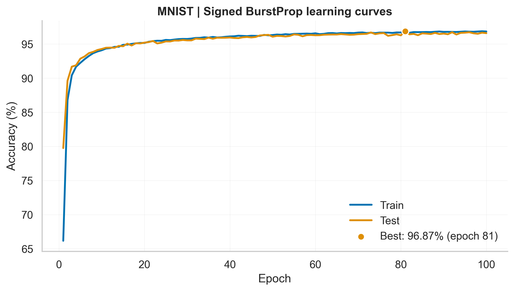
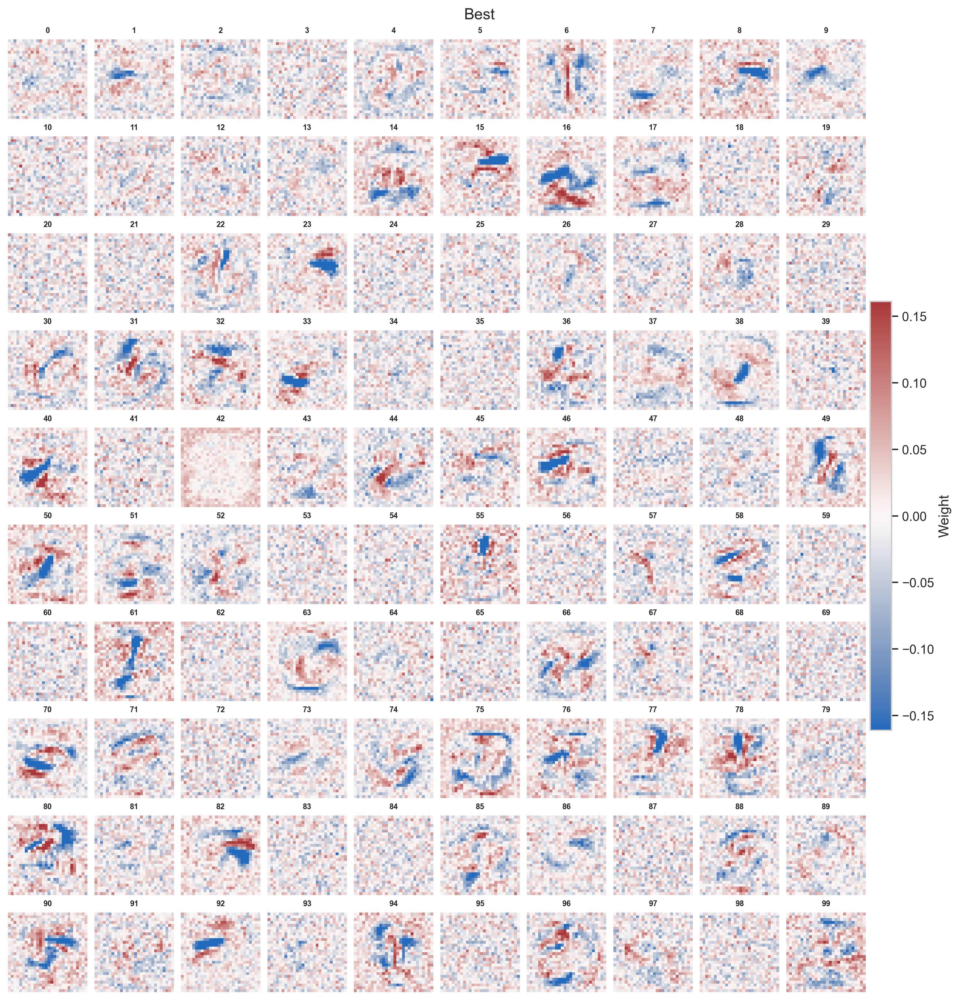

# Signed BurstProp on MNIST

A PyTorch/CUDA implementation of **Signed BurstProp** for online supervised learning in spiking neural networks, based on Stuck, Wang & Naud (2025), [*A burst-dependent algorithm for neuromorphic on-chip learning of spiking neural networks*](https://doi.org/10.1088/2634-4386/adb511).

This repository explores whether a small spiking network can learn MNIST using **local, burst-dependent synaptic plasticity**, without backpropagation through time (BPTT), surrogate gradients, or an automatic-differentiation optimizer. It implements the **signed-burst variant with symmetric feedback**: the feedback weights mirror the feedforward weights, rather than using feedback alignment.

## Learning rule

Neurons emit somatic spikes (events), while the dendritic voltage controls whether an event is marked as a **positive** or **negative** burst. In this implementation,

```math
   P(\mathrm{burst}\mid\mathrm{event})=\tanh(|V_d|), \qquad B^{\pm}=\mathrm{burst}\,\mathbf{1}[\pm V_d>0].
```
Each synapse updates using only a presynaptic eligibility trace and the postsynaptic signed burst signal:

```math
\Delta W_{ij}=-\eta\,e_j^{\mathrm{pre}}(B_i^{+}-B_i^{-}), \qquad \eta=10^{-4}.
```

Output dendrites receive a target-rate error signal; hidden dendrites receive feedback through the transpose of the output weight matrix, with a one-timestep delay. Both feedforward layers are plastic. The model has **784 input units, 100 hidden spiking neurons, and 10 output spiking neurons**. MNIST images are converted into Poisson spike trains at 20–200 Hz and presented for 100 ms (1 ms time steps).

Training is **strictly online**: weights change after each incoming sample, so the next sample sees the updated network. CUDA Graphs bundle sequential samples for faster execution, **not** for minibatch gradient descent. Weight initialization is fluctuation-based; its numerical prefactor is a reproduction choice, not a verified parameter from the original authors.

## MNIST performance

With 100 training epochs, the run reached **96.87% best test accuracy (epoch 81)**, with **96.58% at epoch 100**. For context, Stuck *et al.* report **97.2 ± 0.1%** for Signed BurstProp with symmetric feedback and one 100-neuron hidden layer. That published value is across multiple runs, whereas the result shown here is from a single run; the implementations are not claimed to be numerically identical.

<p align="left">
  
</p>

The input-to-hidden weights can be reshaped into 28 × 28 maps to visualize the learned **receptive fields** of hidden neurons:

<p align="left">
  
</p>

## Run and analyze

Install a CUDA-enabled version of PyTorch together with `torchvision`, `numpy`, `matplotlib`, `seaborn`, and `jupyter`, then run:

```bash
python stuck2025_signed_symetric.py --device cuda --epochs 100
```

The training script saves `config.json`, `history.json`, `best.pt`, and `last.pt` in `results/stuck2025_signed_symetric/` by default. Open `nb_analysis.ipynb` to inspect learning curves, event/burst statistics, synaptic weights, and receptive fields. The analysis figures shown above should be stored in `analysis_figures/`.

## Reference

Stuck, M., Wang, X., & Naud, R. (2025). **A burst-dependent algorithm for neuromorphic on-chip learning of spiking neural networks**. *Neuromorphic Computing and Engineering, 5*(1), 014010. https://doi.org/10.1088/2634-4386/adb511

This is an independent implementation inspired by the article, not the authors' official code.
